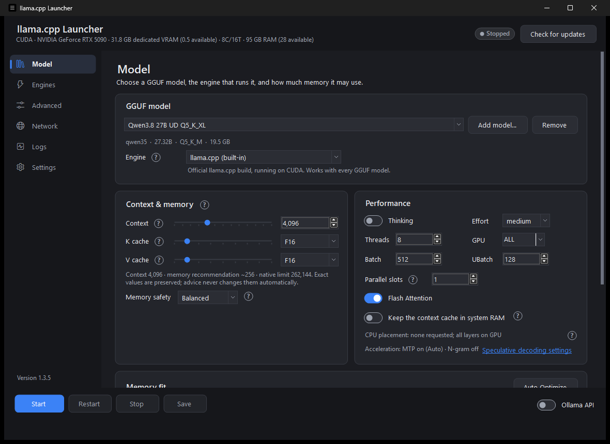
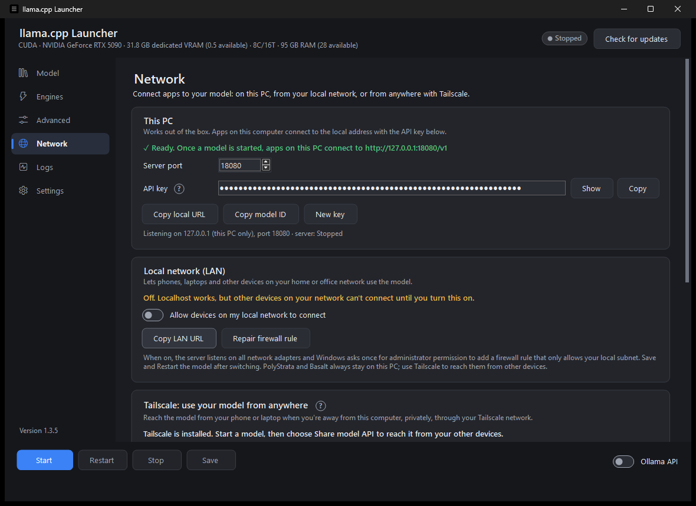

# llama.cpp Launcher

Run local AI models on Windows without the command line. Pick a GGUF model, press **Start**, and any app that speaks the OpenAI API can use it.

**[⬇ Download the latest version (LlamaLauncher-Setup.exe)](../../releases/latest/download/LlamaLauncher-Setup.exe)** · [All releases](../../releases)



- Runs any GGUF model with the official [llama.cpp](https://github.com/ggml-org/llama.cpp) engine, built in for NVIDIA (CUDA), any graphics card (Vulkan) and CPU-only PCs
- Shows whether a model fits in your graphics memory and RAM before you start it, and can pick safe settings for you (Auto Optimize)
- Works on this PC right away; your phone or laptop can connect over your home network or, with Tailscale, from anywhere
- Add more engines when you need them: Basalt for NVIDIA RTX 50-series cards, PolyStrata for large mixture-of-experts models, or your own llama.cpp build
- An optional Ollama-compatible API for apps that only speak Ollama
- Your models and settings stay on your PC

## Install

1. Download **LlamaLauncher-Setup.exe** with the link above.
2. Run it. Windows SmartScreen may say it doesn't recognize the app, because the installer isn't code-signed yet: choose **More info** → **Run anyway**.
3. Click **Launch** on the last page of the installer. You can also open it later from the Start menu.

The installer is per user and includes everything it needs: the app, the .NET runtime and the llama.cpp engines. You don't need Python, a compiler or a separate llama.cpp download. If the Microsoft Visual C++ runtime is missing or too old, the installer adds it (this is the only step that asks for administrator permission). Uninstall from **Settings → Apps** like any other app.

**Requirements:** Windows 10 22H2 or Windows 11 (64-bit), enough RAM for your model, and an up-to-date graphics driver if you want GPU acceleration.

## First launch: choose your engine

On first launch the app asks which engine should run your models and recommends one for your PC:

| Engine | Use it for |
| --- | --- |
| **llama.cpp · NVIDIA (CUDA)** | NVIDIA GeForce and RTX cards. The fastest choice for NVIDIA. |
| **llama.cpp · Any graphics card (Vulkan)** | AMD, Intel and NVIDIA cards. |
| **llama.cpp · Processor only (CPU)** | PCs without a usable graphics card. Slowest, but it works everywhere. |
| **Basalt** | **NVIDIA RTX 50-series (Blackwell) cards only**, such as the RTX 5070, 5080 and 5090. Runs Qwen3.8 Flash-Next from a converted `.basalt` pack. [Installed separately](https://github.com/jesdga95/basalt). |
| **PolyStrata** | Experimental engine for large mixture-of-experts models such as Qwen3.8 Flash-Next. [Installed separately](https://github.com/VecSzn/PolyStrata). |
| **Custom engine** | Your own llama.cpp build: any folder that contains `llama-server.exe`. |

The three llama.cpp options are built in, so there's nothing else to install. You can change your choice, add engines or add a custom engine at any time on the **Engines** page (**Add engine…**), and each model can use a different engine.

## Run a model

1. On the **Model** page, click **Add model…** and pick a `.gguf` file, or drag one onto the window. The file stays where it is. Need a model? Browse [GGUF models on Hugging Face](https://huggingface.co/models?library=gguf&sort=trending).
2. Check **Memory fit**. The bars show how much graphics memory (VRAM) and RAM the model needs against what's free. If it won't fit, lower the context or use **Auto Optimize**.
3. Click **Start**. The status at the top changes to **Running**.

Closing the window keeps the model loaded, and reopening the launcher reconnects to it. **Stop** unloads it.

## Connect your apps

Open the **Network** page for the addresses and the API key.

- **This PC (localhost):** works out of the box. Apps connect to `http://127.0.0.1:8080/v1` with the API key shown on the Network page.
- **Your local network (LAN):** off by default. Other devices on your Wi-Fi or LAN *can't* connect until you turn on **Allow devices on my local network to connect** and then Save and Restart the model. Windows asks once for permission to add a firewall rule that only allows your local subnet.
- **From anywhere, with Tailscale:** [Tailscale](https://tailscale.com/download/windows) is a free app that links your own devices into a private, encrypted network. Install it on this PC and on your phone or laptop, then choose **Share model API** to use your model while you're away from this computer. Nothing is opened to the public internet, and the API key is still required. If Tailscale isn't installed, the Network page offers a download button, which goes away once Tailscale is installed.
- **Ollama-compatible API:** for apps that only speak Ollama's API, turn on the Ollama API switch (port 11434).



## Updating the engine

Click **Check for updates** in the header. The launcher checks the official llama.cpp Windows builds on GitHub and only downloads when you click **Download and install update…**. Downloads are SHA-256 checked and tested before they become active, and **Roll back engine** restores the previous build. Your models and settings are never changed by an engine update.

## Privacy

Settings are stored in `%LOCALAPPDATA%\LlamaLauncher`. API keys stay on your PC, and diagnostic reports leave out keys, paths, model names and conversations. Engine update checks only contact GitHub when you ask, unless you turn on automatic checks. See [technical details](docs/DETAILS.md) for how memory checks, process ownership and the engines work.

## Build from source

You need Windows x64, PowerShell 7, an internet connection and about 5 GB of free space.

```powershell
pwsh -File build.ps1
```

The script downloads a pinned .NET SDK, WiX and the official engine files (all checked against `dependencies.lock.json`), runs the self-tests, and writes `dist/Setup.exe`, `dist/source.zip` and `dist/build-report.txt`.

## License

MIT, see [LICENSE](LICENSE). Bundled components keep their own licenses; see [licenses](licenses). This project is not affiliated with the llama.cpp project, NVIDIA, Basalt, PolyStrata, Tailscale or Ollama.
